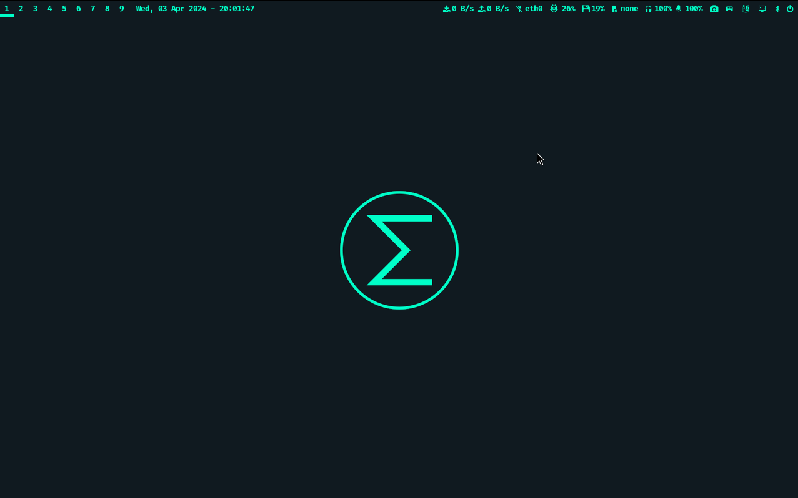
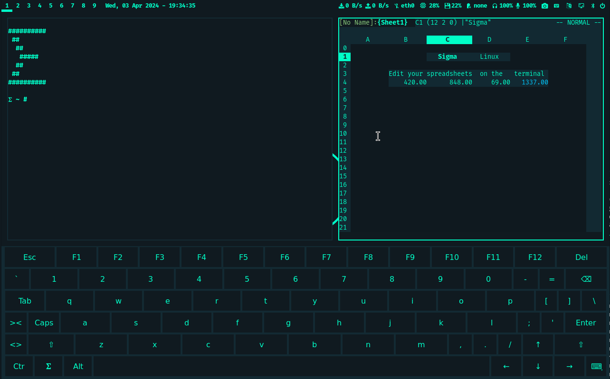
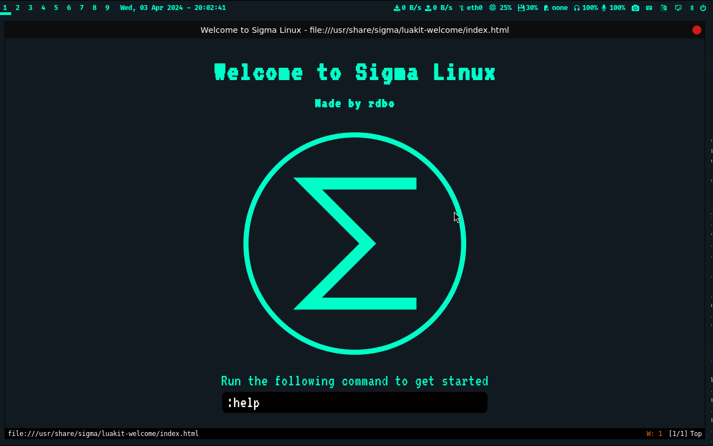
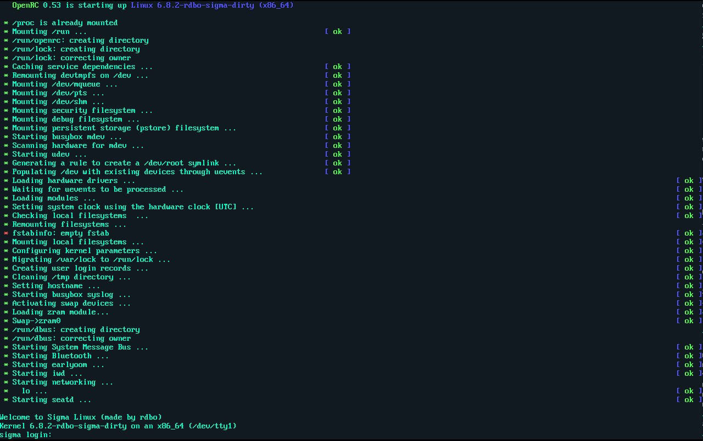
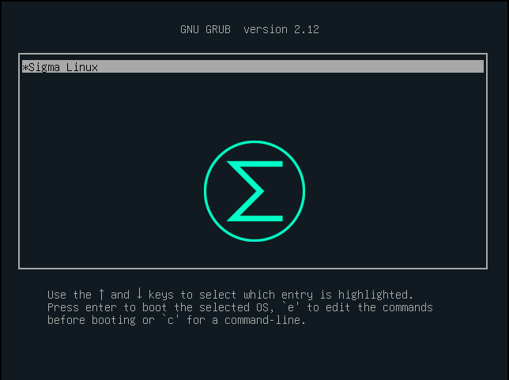

# Sigma Linux
## Elite operating system

# Building

Everything goes through one command, `./sigma`. It needs Ruby (standard library only) and Docker: build commands run themselves inside the build container, so the host needs nothing else.

```sh
./sigma build              # build the ISO: out/sigma-linux.iso
./sigma run                # boot it in QEMU (--uefi for UEFI firmware)
```

The build is a pipeline of four stages, and a bare `./sigma build` skips the stages that are already up to date:

```
packages ──▶ rootfs ──▶ squashfs ──▶ iso
```

| Stage | What it does | Output |
|---|---|---|
| `packages` | builds the local packages (`packages/`) the profile needs into a signed repository | `cache/repo/` |
| `rootfs` | installs the profile into a fresh root filesystem and configures it | `cache/rootfs/` |
| `squashfs` | compresses the root filesystem | `cache/rootfs.squashfs` |
| `iso` | assembles a bootable image with a menu entry per kernel | `out/sigma-linux.iso` |

Naming a stage (or part of one) runs just that:

```sh
./sigma pkg linux-sigma           # build one package and stop
./sigma build rootfs..            # rootfs and everything after it
./sigma build ..squashfs          # everything up to the squashfs
./sigma build rootfs:configure    # one step of a stage
./sigma build --plan              # show what would run
./sigma status                    # what is built, what is stale, and why
./sigma clean rootfs..            # delete outputs (downloads and built packages stay)
./sigma shell                     # a shell in the build container
```

Packages rebuild when anything in their `packages/<name>/` directory changes. To install a freshly built package on the machine you're on (a new kernel, say), `./sigma pkg` prints the `apk add` command.

## Configuration

`config/sigma.yml` holds the defaults: name, profile, users, services, compression and so on. Put personal overrides in `config/local.yml` (git-ignored, same shape), or pass them for one run with `--set key=value`. `./sigma config` prints the result.

| Path | Contents |
|---|---|
| `packages/` | local APKBUILDs |
| `profiles/` | package lists: `minimal` ⊂ `standard` ⊂ `full` (`@include` composes them) |
| `image/overlay/` | files copied verbatim onto the root filesystem |
| `image/grub.cfg.erb` | the live ISO's boot menu |
| `cache/` | intermediate state, safe to delete; logs in `cache/logs/latest/` |

The boot menu's look (resolution, wallpaper, console colours) lives in `packages/sigma-conf/rootfs/usr/share/sigma/grub/grub.conf`, shared by the ISO and installed systems. On an installed system, `sigma-grub-setup` hooks it into `/etc/default/grub`, so the menu keeps its theme when kernel updates regenerate it. Installs made before this fix can run it once to migrate: `doas sigma-grub-setup`.

## CI

GitHub Actions (`.github/workflows/build-iso.yml`) runs the tests on every push and pull request. The full ISO build runs for version tags and on demand (`gh workflow run build-iso.yml --ref <branch>`). After building, it boots the ISO in QEMU (`.github/boot-test.sh`) and uploads it as the run's `sigma-linux` artifact. Pushing a `v*` tag also publishes the ISO as a GitHub release. Builds carry ccache between runs, so a rebuild after a kernel bump only recompiles what changed.

## Resources

A full build needs about 35 GB of free disk space (the kernel alone takes 15-20 GB while it builds). `jobs: auto` uses one core less than the machine has, and at most one job per 1.5 GiB of RAM, so the system stays usable. Run the tests with `ruby test/run.rb`.

# License
This project is licensed under the GNU AGPL-3.0 (no later versions allowed)

All the files in this repository follow the license in the file `LICENSE` present in this directory, unless explicitly said otherwise (e.g through a CREDITS or another LICENSE file)

Note that packages under `packages/` will have their license names noted at the `APKBUILD` file

Packages installed from the package repository will have their own licenses as well

# Screenshots






